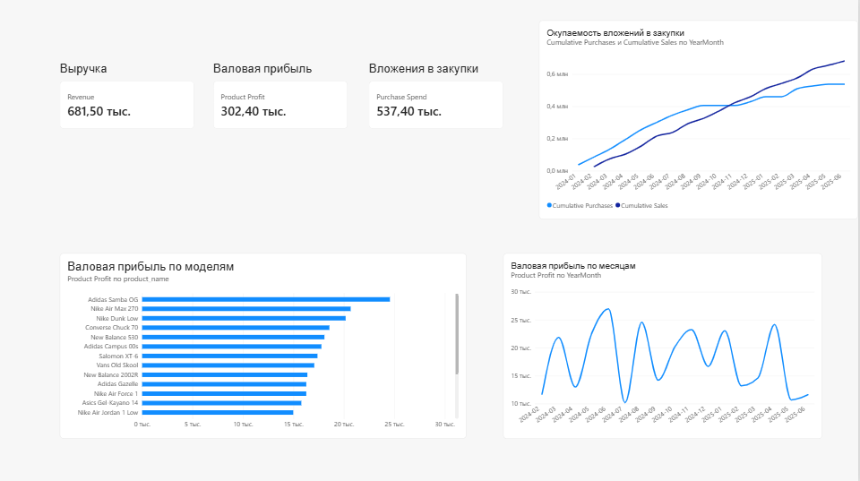

# Sneaker Store Data Analysis

Аналитический проект интернет-магазина кроссовок с использованием **PostgreSQL, SQL, Power BI и DAX**.

Цель проекта — проанализировать продажи и закупки, определить наиболее прибыльные модели кроссовок, изучить динамику валовой прибыли и оценить, когда вложения в товарные закупки окупаются за счёт поступлений от продаж.

> Проект выполнен на учебных данных и предназначен для демонстрации навыков анализа данных, работы с SQL и построения BI-отчётности.

## Стек

- PostgreSQL
- SQL
- Power BI
- DAX
- Power Query

## Бизнес-задачи

В рамках проекта были поставлены следующие задачи:

- рассчитать выручку магазина;
- определить валовую прибыль;
- проанализировать затраты на закупки;
- определить наиболее прибыльные модели кроссовок;
- изучить динамику прибыли по месяцам;
- оценить денежный результат;
- определить момент окупаемости вложений в товарные закупки.

## Структура данных

В базе данных используются следующие основные таблицы:

- `users` — пользователи магазина;
- `products` — ассортимент товаров;
- `orders` — заказы;
- `order_items` — позиции заказов;
- `payments` — платежи;
- `purchases` — партии закупок товара.

Также создано представление:

- `vw_product_cashflow` — объединяет денежные потоки от закупок и продаж и используется для анализа окупаемости.

Упрощённая схема связей:

```text
users
  |
  | 1:N
  v
orders
  |
  | 1:N
  v
order_items -------- N:1 -------- products
                                   |
                                   | 1:N
                                   v
                               purchases

orders
  |
  | 1:N
  v
payments
```

## SQL

В папке `sql` находятся основные SQL-файлы проекта:

```text
sql/
├── 01_create_tables.sql
├── 02_insert_data.sql
├── 03_create_views.sql
└── 04_analysis.sql
```

Назначение файлов:

- `01_create_tables.sql` — создание структуры базы данных;
- `02_insert_data.sql` — загрузка тестовых данных;
- `03_create_views.sql` — создание аналитических представлений;
- `04_analysis.sql` — SQL-запросы для анализа продаж, прибыли и закупок.

В аналитической части используются `JOIN`, `GROUP BY`, агрегатные функции, фильтрация, работа с датами и расчёт производных бизнес-метрик.

## Ключевые показатели

По данным проекта получены следующие результаты:

| Показатель | Значение |
|---|---:|
| Выручка | 681 500 ₽ |
| Валовая прибыль | 302 400 ₽ |
| Вложения в закупки | 537 400 ₽ |

**Валовая прибыль** рассчитывается как разница между ценой продажи и исторической себестоимостью проданного товара.

## Power BI Dashboard

Для визуализации результатов разработан интерактивный дашборд Power BI.

Основные элементы дашборда:

- карточки с ключевыми показателями;
- валовая прибыль по моделям кроссовок;
- динамика валовой прибыли по месяцам;
- сравнение накопленных продаж и накопленных затрат на закупки;
- анализ окупаемости вложений в товарные запасы.



Файл отчёта Power BI:

[Открыть файл Power BI](powerbi/sneaker_store_dashboard.pbix)

## Основные DAX-меры

### Выручка

```DAX
Revenue =
CALCULATE(
    SUM('public payments'[amount]),
    'public payments'[status] = "paid"
)
```

### Валовая прибыль

```DAX
Product Profit =
CALCULATE(
    SUMX(
        'public order_items',
        (
            'public order_items'[price]
            - 'public order_items'[unit_cost]
        )
        * 'public order_items'[quantity]
    ),
    'public orders'[status] = "completed"
)
```

### Затраты на закупки

```DAX
Purchase Spend =
SUMX(
    'public purchases',
    'public purchases'[quantity]
        * 'public purchases'[unit_purchase_price]
)
```


### Накопленные продажи

```DAX
Cumulative Sales =
VAR CurrentDate =
    MAX(Calendar[Date])
RETURN
    CALCULATE(
        [Sales Cash],
        FILTER(
            ALL(Calendar[Date]),
            Calendar[Date] <= CurrentDate
        )
    )
```

### Накопленные закупки

```DAX
Cumulative Purchases =
VAR CurrentDate =
    MAX(Calendar[Date])
RETURN
    CALCULATE(
        [Purchase Cash],
        FILTER(
            ALL(Calendar[Date]),
            Calendar[Date] <= CurrentDate
        )
    )
```

## Анализ окупаемости

Для оценки окупаемости товарных закупок сравниваются:

- накопленные денежные поступления от продаж;
- накопленные затраты на закупку товара.

Точка пересечения двух линий показывает момент, когда накопленные поступления от продаж покрыли вложения в товарные закупки.

Показатель отражает окупаемость товарных запасов, но не полную окупаемость бизнеса, так как в модели не учитываются операционные расходы.


## Структура репозитория

```text
sneaker-store-data-analysis/
├── README.md
├── sql/
│   ├── 01_create_tables.sql
│   ├── 02_insert_data.sql
│   ├── 03_create_views.sql
│   └── 04_analysis.sql
├── powerbi/
│   ├── sneaker_store_dashboard.pbix
│ │ └── dashboard_overview.png
```


